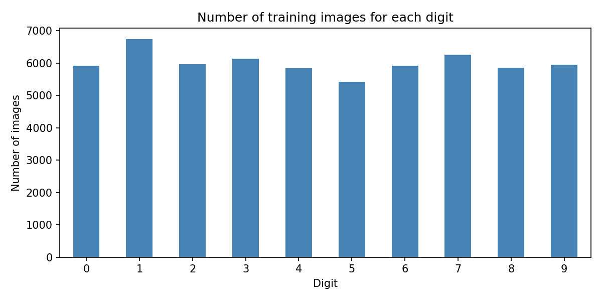
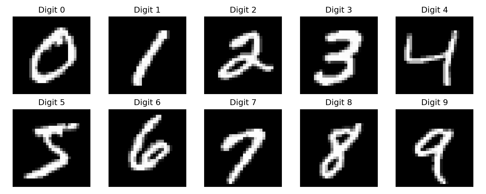

# MNIST Dataset Exploration

My Week 1 computer vision practice. I downloaded a dataset from Kaggle, explored it using Pandas, and checked what kind of machine learning problem it represents.

## Dataset

I chose [MNIST in CSV on Kaggle](https://www.kaggle.com/datasets/oddrationale/mnist-in-csv) by Dariel Dato-on. It contains handwritten digit images stored as numbers in CSV files. Kaggle lists this version as CC0 (public domain).

- Training file: 60,000 rows
- Test file: 10,000 rows
- Columns: 785 in each file
- `label`: the correct digit, from 0 to 9
- Other 784 columns: pixel values for a 28 x 28 grayscale image

The full CSV files stay outside GitHub because they are large. The download script gets them directly from Kaggle. The notebook already contains the results, so you can read it on GitHub without downloading anything.

## What I checked

I used `head()`, `shape`, `info()`, `describe()`, and `isnull()` like the class practice. I also checked duplicates, counted each label, filtered digit 7, selected digits 0 and 1, and grouped average pixel intensity by label.

| Question | Result |
| --- | --- |
| Are there missing values? | No, in either file |
| Are there duplicate rows? | No, within either file |
| What is the pixel range in the training data? | 0 to 255 |
| Which training digit appears most? | 1, with 6,742 images |
| Which training digit appears least? | 5, with 5,421 images |
| How many training images show digit 7? | 6,265 |
| How many training images show 0 or 1? | 12,665 |

There is some variation in the class counts, but every digit has thousands of examples. The first few corner pixels are always zero in the displayed statistics. That makes sense because those positions are in the black background. The mean of `label` is just a numeric summary, not a meaningful average digit category.





## Supervised or unsupervised?

This is **supervised learning** because the correct answer is already given in the `label` column.

The task is **multiclass classification**: predict which of ten digit categories an image belongs to. Even though the labels are numbers, we treat them as categories. We are not predicting a continuous amount, so this is not regression.

The inputs are the 784 pixels. The target is `label`. The target must be kept out of the input features.

## Which model would I use?

I would start with **K-Nearest Neighbors (KNN)**. It compares an image with nearby labeled examples and uses their labels to make a prediction. It is easy to understand, although prediction can become slow with many images. Pixel distance can also be affected by shifts in handwriting.

A **Convolutional Neural Network (CNN)** is a later option because it can learn local image patterns, such as strokes and curves. It requires more setup and training. I cannot say which performs better here because I have not trained or compared models.

For an unsupervised exercise, I could ignore the labels and try **K-Means** to group similar images. The cluster numbers would not automatically match the correct digits.

Before training, I would divide the original training file into training and validation sets, keeping similar label proportions. I would divide pixel values by 255 for both training and inference. I would use validation data to choose settings, then evaluate once on the original test file using accuracy and a confusion matrix.

**This submission is dataset exploration and model selection reasoning. No model has been trained and no accuracy result is claimed.**

## How to run

Use Python 3.10 or newer. In Windows PowerShell, open this project folder and run:

```powershell
python -m venv venv
.\venv\Scripts\python.exe -m pip install -r requirements.txt
.\venv\Scripts\python.exe download_data.py
.\venv\Scripts\python.exe explore_dataset.py
```

The first download needs internet access. If Kaggle blocks the public download on your network, download the ZIP from the dataset page and put its two CSV files in `data/`.

To work through the notebook:

```powershell
.\venv\Scripts\python.exe -m notebook dataset_exploration.ipynb
```

Open it with the project folder as the working directory, then run the cells from top to bottom. The Python script and notebook cover the same exploration. Charts are saved in `outputs/`.

## OpenCV video practice

The Week 1 slides also ask for a script that reads a video, draws boxes and text, and saves the result. Run:

```powershell
.\venv\Scripts\python.exe video_practice.py
```

This first makes a 10-second slideshow from ten MNIST images, then reads that video frame by frame and adds a fixed green box, a title, and frame numbers. The saved result is [week1_output.mp4](outputs/week1_output.mp4). The box marks the center area. It is not a detected bounding box, and the script does not predict digits. The output has no audio.

You can also pass your own video:

```powershell
.\venv\Scripts\python.exe video_practice.py --input "C:\path\to\video.mp4"
```

This replaces the local output video. It uses the input frame size and FPS, and draws the same fixed center box. It does not copy audio. There are no desktop window calls, so the drawing loop can also run in notebook environments.

## Files

- `dataset_exploration.ipynb`: notebook with executed queries and charts
- `explore_dataset.py`: the same exploration as a simple script
- `download_data.py`: download the Kaggle CSV files
- `video_practice.py`: OpenCV video exercise
- `outputs/`: charts, label counts, and the saved output video
- `requirements.txt`: packages to install

## What I learned

A dataset is easier to understand after checking its shape, labels, missing values, and sample images. Having numbers in a CSV does not always mean regression. Here, the numbers represent image pixels and digit categories, so classification fits the problem.

MNIST is a useful learning dataset. These results do not show how a future model would perform on phone photos or handwriting outside this dataset.
